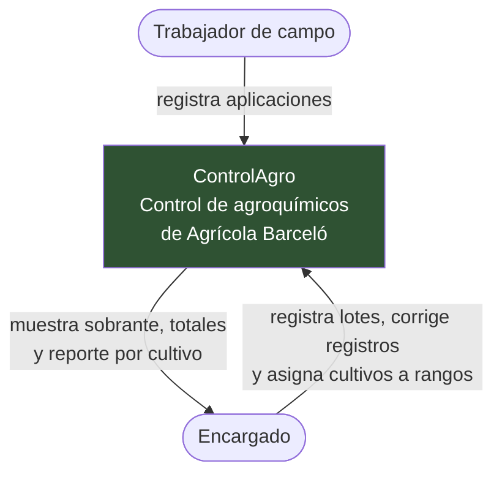
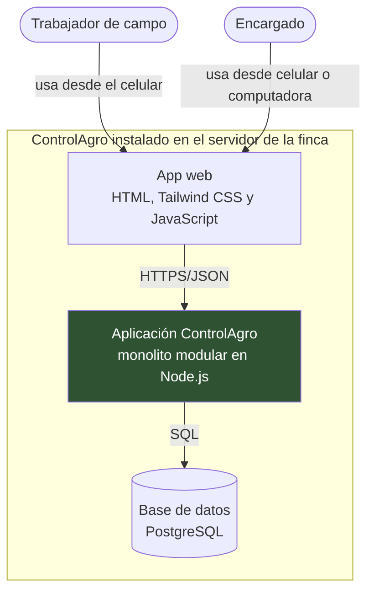
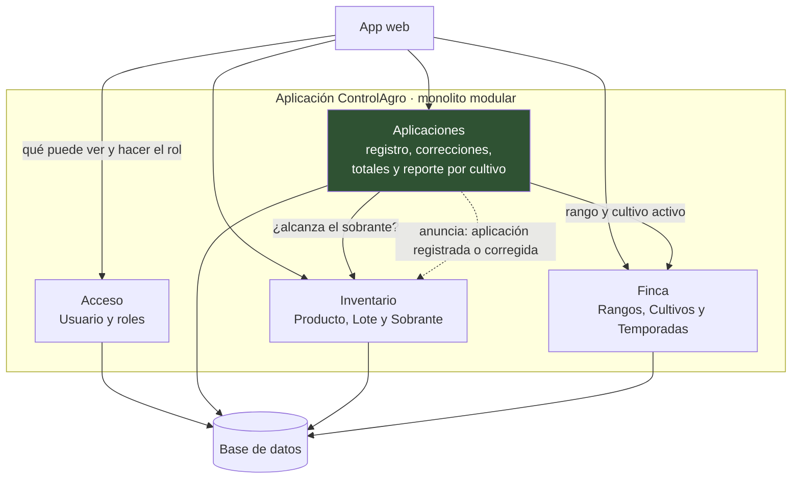

# Documentación de arquitectura: ControlAgro

Luis Pablo Apodaca

---

## 1. Nivel 1 · Diagrama de contexto

El sistema completo como una sola caja, quién lo usa y con quién se comunica. No incluye tecnología.

**Sistemas externos: ninguno.** El alcance de la especificación excluye sensores, drones, proveedores, facturación y reportes para autoridades, así que ControlAgro no se comunica con ningún sistema ajeno. Si en el futuro se integrara con el sistema contable o de compras del cliente, aparecería aquí como una caja nueva.

---

## 2. Nivel 2 · Diagrama de contenedores

Las piezas que se despliegan y se ejecutan por separado, con su tecnología. El `subgraph` dibuja la frontera del sistema, que se instala en el servidor de la finca.

Las tecnologías son la propuesta de este documento. Si el equipo usa otras, solo cambian las etiquetas: la estructura de tres piezas se mantiene.

---

## 3. Nivel 3 · Diagrama de componentes

Lo que hay dentro del contenedor **Aplicación ControlAgro**, donde viven las reglas de negocio. Son los cuatro módulos de la Actividad 2. Solo Aplicaciones habla con otros módulos, y Acceso queda aislado.

