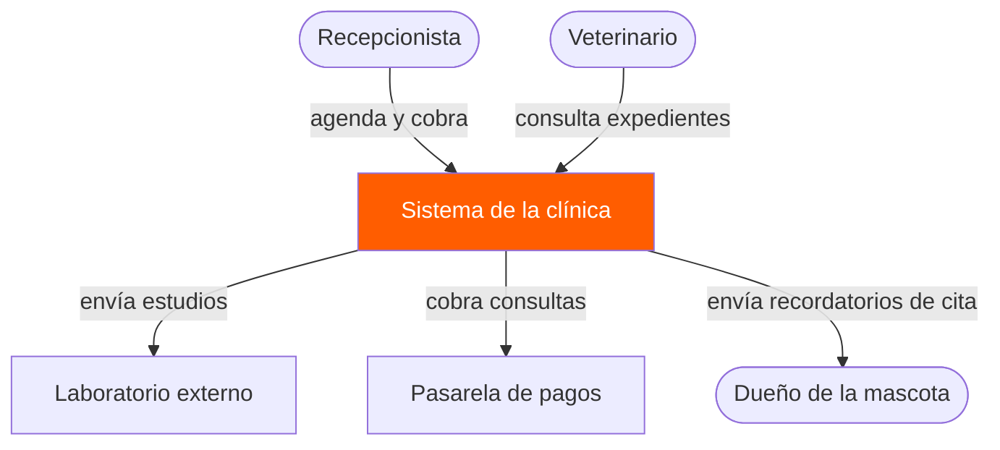
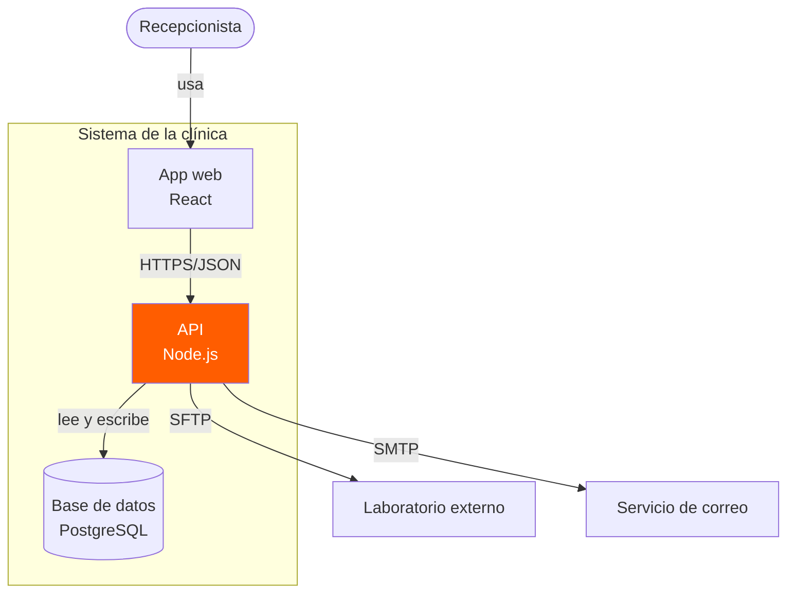
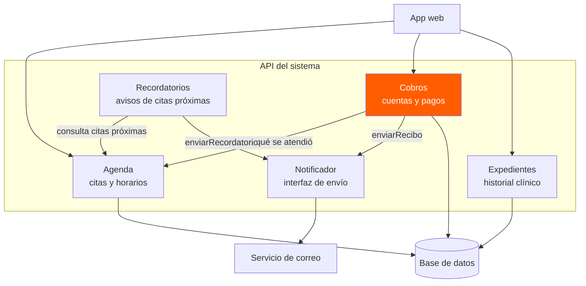
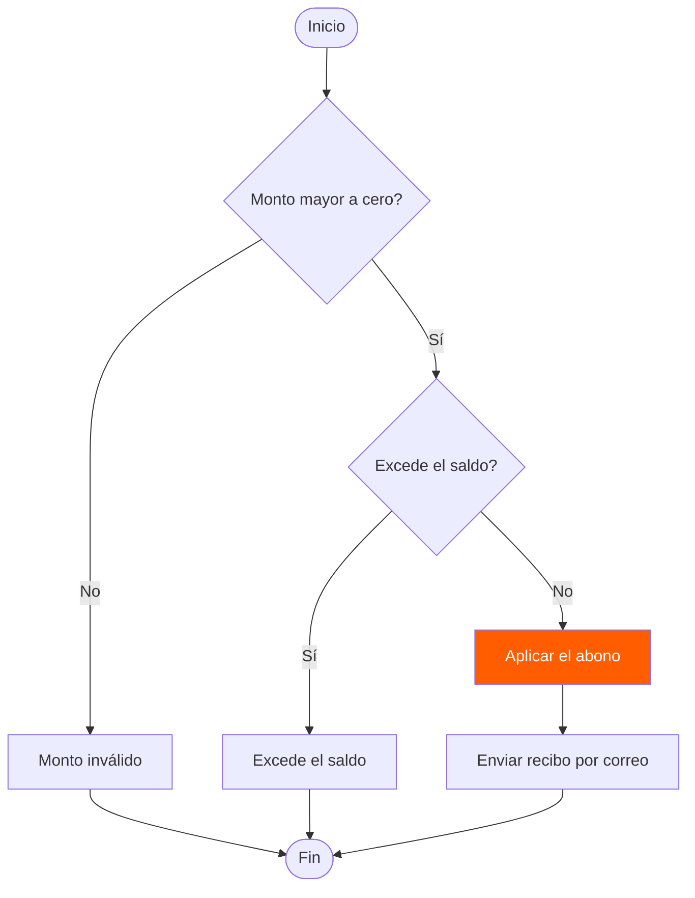
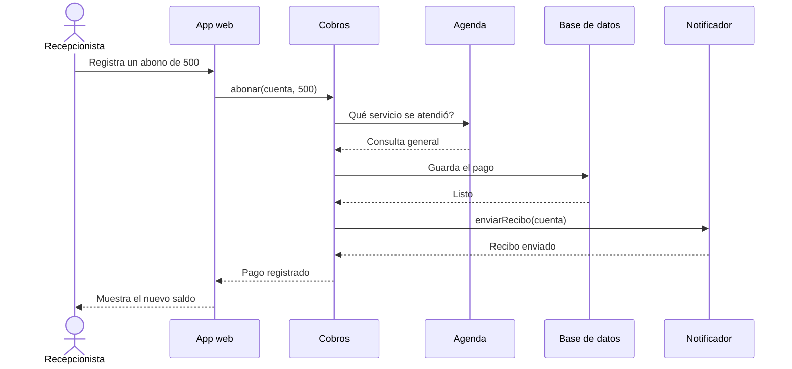
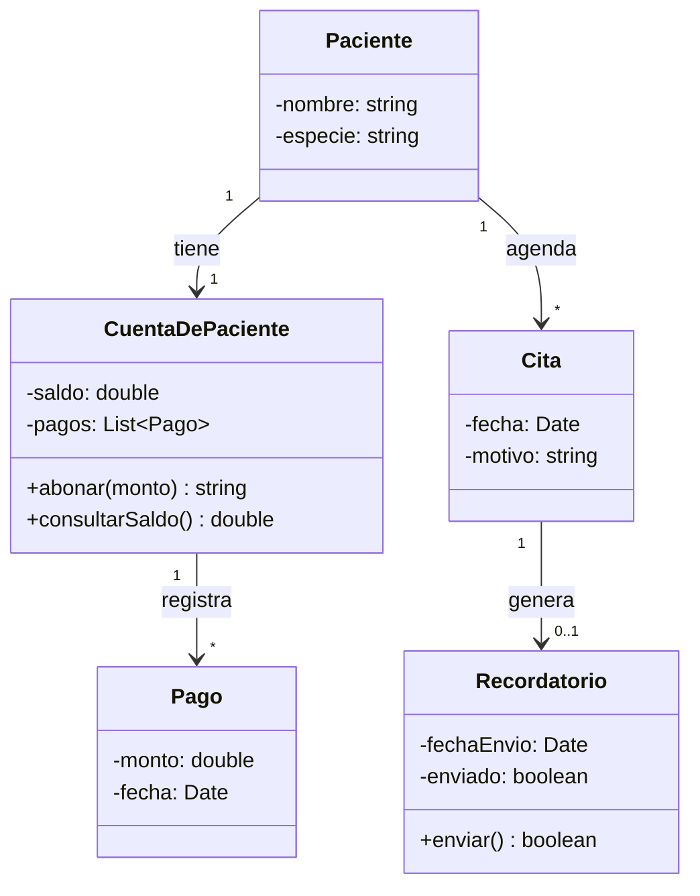
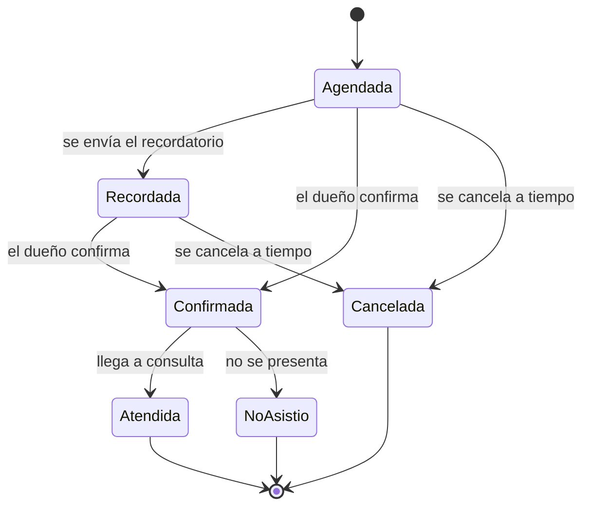
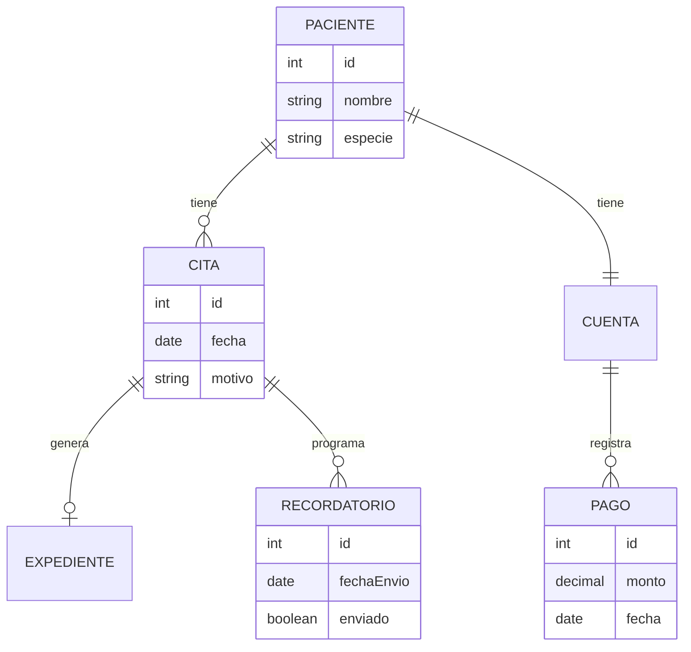

# Diagramas de arquitectura y diseño: Sistema de la clínica veterinaria

Luis Pablo Apodaca

---

## 1. Diagrama de contexto

El sistema completo, quién lo usa y con quién se comunica. No incluye tecnología.

<!-- NUEVO: actor "Dueño de la mascota" y la flecha de recordatorios -->

---

## 2. Diagrama de contenedores

Las piezas que se despliegan y se ejecutan por separado. El `subgraph` dibuja la frontera del sistema.

<!-- NUEVO: sistema externo "Servicio de correo" y la flecha SMTP -->

---

## 3. Diagrama de componentes

Lo que hay dentro del contenedor API. Cobros le pregunta a Agenda en lugar de leer sus tablas (regla del ADR), y el Notificador es una interfaz, no un servicio concreto (patrón Adapter).

<!-- NUEVO: componente Recordatorios; usa a Agenda y al Notificador, nunca al correo directo -->

---

## 4. Diagrama de flujo con decisiones

El flujo de validaciones del abono. Los rombos son decisiones y las flechas se etiquetan con Sí y No.

<!-- NUEVO: paso "Enviar recibo por correo" después de aplicar el abono -->

---

## 5. Diagrama de secuencia

Cómo se pasan los mensajes entre las piezas, en orden y en el tiempo.

<!-- NUEVO: participante Notificador y los mensajes enviarRecibo / Recibo enviado -->

---

## 6. Diagrama de clases

Atributos, métodos, visibilidad y multiplicidad. `-` es privado y `+` es público.

<!-- NUEVO: clases Cita y Recordatorio, con sus relaciones -->

---

## 7. Diagrama de estados

Por qué estados pasa una cita y qué evento la mueve.

<!-- NUEVO: estado Recordada, entre Agendada y Confirmada -->

---

## 8. Diagrama entidad-relación

Las tablas de la base de datos y cómo se relacionan. `||` es uno y exactamente uno, `o{` es cero o muchos y `o|` es cero o uno.

<!-- NUEVO: tabla RECORDATORIO relacionada con CITA -->
